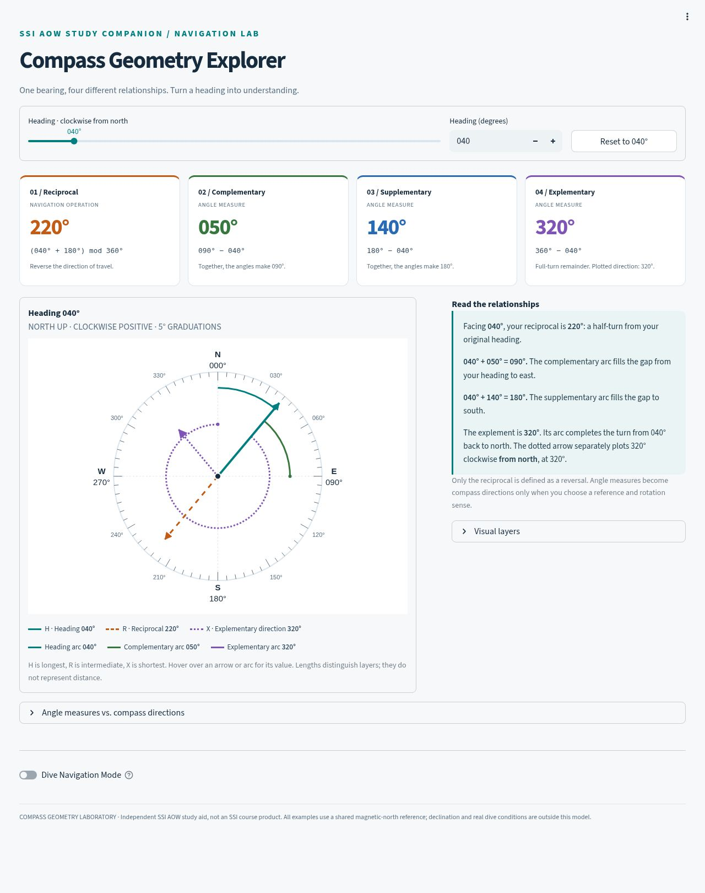
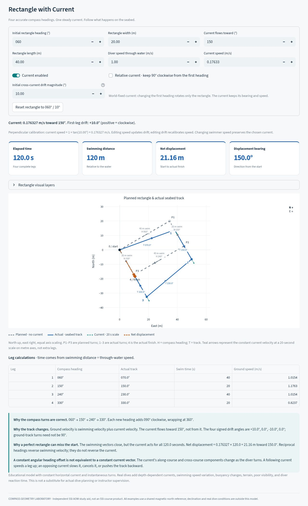

# Compass Geometry Laboratory

A local Python application for exploring one compass heading through four
different relationships, with optional dive navigation experiments. Built with
Streamlit and Plotly. No API keys, accounts, or paid services are required.

Source repository: [Kighway/ssi-advanced-diver](https://github.com/Kighway/ssi-advanced-diver).
For the hosted service and deployment settings, see [DEPLOYMENT.md](DEPLOYMENT.md).



## Install and launch

Requires Python **3.12 or newer**. Tested with Python **3.12.14** on Linux.
Internet access is needed to install packages; the application itself uses no
external data service and works locally after installation.

Clone this repository (or unzip the standalone archive) and open a terminal in
the directory containing `app.py`.

### macOS / Linux

```bash
python3.12 -m venv .venv
source .venv/bin/activate
python -m pip install -r requirements-lock.txt
streamlit run app.py
```

If your installed Python is newer, substitute its command for `python3.12`.
Open **http://127.0.0.1:8501**. Stop the server with **Ctrl+C**.

### Windows (PowerShell or Command Prompt)

```powershell
py -3.12 -m venv .venv
.venv\Scripts\python.exe -m pip install -r requirements-lock.txt
.venv\Scripts\python.exe -m streamlit run app.py
```

These commands do not require activating a PowerShell script. From an activated
environment, `streamlit run app.py` works on all three platforms.

`requirements.txt` pins the three direct dependencies. `requirements-lock.txt`
also pins the complete dependency set used for verification; use that file to
reproduce the tested environment. Only Python 3.12.14 / Linux was executed here;
the launch instructions for other platforms are provided, not claimed tested.

## Controls

- **Heading slider:** drag from 000° to 359°, or focus it and use arrow keys.
  Changes commit when you release the slider. The numeric field, four cards,
  explanation, arrows, arcs, and the first three dive exercises update on the
  same rerun. The rectangle exercise has its own independent heading.
- **Heading (degrees):** type a whole number, then press Enter or leave the
  field. The slider follows it. Bounds are 0 and 359, inclusive.
- **Reset to 040°:** restores both heading controls to 040°. Layer choices and
  dive settings remain yours; resetting the heading does not erase them.
- **Visual layers:** independently show/hide each of the three arrows, five
  arcs, and degree graduations. Invalid complementary/supplementary arcs are
  hidden regardless of the checkbox. A zero-sized arc is represented by a point.
- **Short chart transitions:** requests a 180 ms Plotly transition; disable it
  for reduced motion. Smooth tweening depends on browser/Streamlit redraw
  behavior. The app does not promise continuous animation while dragging.
- **Hover:** inspect the name and value of each visible vector or arc.
- **Dive Navigation Mode:** off initially; turn it on to reveal the optional
  experiments. The central four-relationship explorer always stays visible.

The compass is north-up, with bearings increasing clockwise. Arrows use color,
stroke style, names, and different lengths. R and X retain separate arrowheads
when they coincide at 090° or 270°. Arrow lengths do not encode distance.
The layout uses four calculation cards across on desktop and two across on
narrower screens; the control/chart columns stack at phone widths.

## The four relationships

For a normalized heading θ in [0°, 360°):

| Relationship | Rule | At 040° | Meaning |
|---|---|---|---|
| Reciprocal | (θ + 180°) mod 360° | 220° | Opposite compass direction |
| Complementary | 90° − θ, only for 0° ≤ θ ≤ 90° | 050° | Nonnegative angle completing a right angle |
| Supplementary | 180° − θ, only for 0° ≤ θ ≤ 180° | 140° | Nonnegative angle completing a straight angle |
| Explementary | 360° − θ | 320° | Angle completing a full turn |

No wraparound is applied to a negative complement or supplement: those results
are **N/A**. Endpoint zero measures are valid. At heading 000°, the explementary
**measure is 360°**, while its plotted **direction is 000°**.

### Why the purple arrow and arc are different

The **explementary arc** starts at θ and continues clockwise to north through
360° − θ. The **explementary arrow** takes that resulting measure and plots it
clockwise **from north**, at (360° − θ) mod 360°. The arrow is the original
direction reflected across the north–south axis. It is not generally the return
bearing. At 040°, its direction is 320°, whereas the return bearing is 220°.

Other arcs use the same explicit starting-point convention:

| Arc | Start | Clockwise sweep | Endpoint |
|---|---|---|---|
| Heading | North | θ | Heading |
| Reciprocal | Heading | 180° | Reciprocal direction |
| Complementary | Heading | 90° − θ | East |
| Supplementary | Heading | 180° − θ | South |
| Explementary | Heading | 360° − θ | North |

## Dive Navigation Mode

**Return & bezel:** compares the outbound instrument with two return methods.
Rotate the bezel markers 180° relative to the housing and align N, or leave the
original bezel setting unchanged and align S. Both require the diver to face
the reciprocal bearing. The instrument diagrams keep **body forward up**;
the main compass keeps **north up**. Rotating a bezel alone does not turn the
diver. The two methods are derived from the same opposite-end geometry.

**90° turns & square:** displays clockwise/right (+90°) and
counterclockwise/left (−90°) turns with wraparound. Choose square direction and
leg length. From 040°, a clockwise square uses 040°, 130°, 220°, 310°.
Equal actual distances and still water are assumed.

**Heading vs. track:** adds a through-water swimming velocity to a current
velocity. Set swimming speed, current speed/direction, and duration. Current
direction always means **flowing toward** the bearing. The default current is
90° to the right of the heading. Disable that option for a fixed direction.
An exactly cancelling current produces zero ground speed and an **undefined**
track bearing. Turning onto a reciprocal reverses the swimming vector, not the
current vector.

### Rectangle with Current

Enable **Dive Navigation Mode**, then select **Rectangle with Current**.
This fourth exercise has independent scenario controls; the original explorer
remains visible and starts at 040°. The rectangle starts at **060°**.



The default is a 40 m × 20 m clockwise rectangle, swimming at 1.0 m/s relative
to the water. Current flows **toward 150°**, not from 150°. All bearings use the
same magnetic-north reference. Changing the initial heading rotates the planned
rectangle while preserving successive +090° turns.

| Leg | Compass heading | Swim distance | Actual track | Swim time | Ground speed |
|---|---|---|---|---|---|
| 1 | 060° | 40 m | 070.0° | 40 s | 1.0154 m/s |
| 2 | 150° | 20 m | 150.0° | 20 s | 1.1763 m/s |
| 3 | 240° | 40 m | 230.0° | 40 s | 1.0154 m/s |
| 4 | 330° | 20 m | 330.0° | 20 s | 0.8237 m/s |

The default current is perpendicular to the first heading, so its speed is
`1.0 × tan(10°) = 0.1763269807 m/s`. After **120 s** and **120 m of swimming**,
the final displacement is **21.1592 m toward 150°** (10.5796 m east and
18.3244 m south). The net displacement is current velocity × total elapsed time.

Controls:

- **Initial rectangle heading, length, width, and diver speed:** type a value
  and press Enter or leave the field. Distances are through-water swimming
  distances, not ground-track distances. Each leg lasts distance ÷ diver speed.
- **Current flows toward / current speed:** set the physical current independently.
  By default, changing the heading or swimmer speed preserves the current's
  bearing and speed. The first-leg drift is recalculated by vector addition.
- **Initial cross-current drift magnitude:** editable only when the current is
  perpendicular to the initial heading (and its drift is within the 0–89° input
  range). Editing drift recalibrates current speed; editing speed recalculates
  drift. Current direction determines the side of the drift. For oblique or
  along-course current, only the calculated drift is shown.
- **Relative current:** explicitly makes the current stay 90° clockwise from
  the initial heading when that heading changes. Even in this mode, the current
  stays constant across all four legs of each simulation.
- **Current enabled:** switch off to make planned and actual coordinates exactly
  coincide and close. The configured speed is retained for re-enabling.
- **Rectangle visual layers:** independently hide/show the planned path, actual
  track, current arrows, and H/T bearing labels. The endpoint and displacement
  remain visible. P1–P3 are planned turns; 1–3 are actual turns; 4 is the finish.
- **Reset rectangle to 060° / 10°:** restores the complete default scenario and
  its visual layers without changing the original explorer's heading.

The neutral dashed route is the planned no-current rectangle; blue is the
actual seabed track; orange shows net displacement. Teal current arrows use a
**20-second display scale** on metre axes: their length is current speed × 20 s,
not a separate swim leg. The chart stays north-up, east-right, with equal axis
scales. On narrow screens, scroll the leg table horizontally to see all columns.

For each leg, with east `x` and north `y`:

```text
swim velocity = swim speed × (sin heading, cos heading)
current velocity = current speed × (sin current bearing, cos current bearing)
ground velocity = swim velocity + current velocity
leg time = swim distance / swim speed
leg displacement = ground velocity × leg time
track bearing = degrees(atan2(ground east, ground north)) mod 360
ground speed = hypot(ground east, ground north)
```

The model constructs an exactly closed planned polygon from two perpendicular
basis vectors. Each actual vertex is its planned vertex plus current velocity
× elapsed time, equivalent to integrating ground velocity over each leg. A
zero ground velocity has an **undefined** track. A stronger opposing current
can move the diver backward over the seabed while their compass heading stays
unchanged. Zero net displacement likewise has no displacement bearing.

**A constant angular heading offset is not equivalent to a constant current
vector.** The default leg drifts are +10°, 0°, −10°, and 0°. Reciprocal headings
cancel the swimming vectors, while the steady current accumulates throughout
the exercise. Real dives also involve depth-dependent currents, varying swim
speed, buoyancy, terrain, poor visibility, and reaction time. This educational
model does not replace actual dive planning or instructor supervision.

The model uses a flat local plane with constant velocities, no shear, and a
shared magnetic-north reference. It is a geometry study tool, not a site-current
forecast or an SSI course product. It does not model declination, compass tilt,
obstacles, or a diver's operational limits.

## Code organization

| File | Responsibility |
|---|---|
| `geometry.py` | Pure angle functions, formatting, coordinate conversions, arcs |
| `navigation_scenarios.py` | Pure turns, square course, bezel states, current vectors |
| `compass_visualization.py` | Plotly SVG figures and independent layer visibility |
| `app.py` | Streamlit controls, synchronized state, explanations, responsive layout |
| `rectangle_simulation.py` | Pure rectangle integration, velocity results, perpendicular drift calibration |
| `rectangle_visualization.py` | Planned/actual routes, current arrows, endpoint, independent layers |
| `rectangle_view.py` | Rectangle controls, state synchronization, table, explanations |
| `tests/test_geometry.py` | Cardinals, intercardinals, boundaries, invalid inputs, all 360 integer headings |
| `tests/test_navigation.py` | Bezel equivalence, square closure, analytic current results |
| `tests/test_visualization.py` | Arrow coordinates, arc validity, coincidence and layer behavior |
| `tests/test_app.py` | Streamlit AppTest control, reset, figure and exercise integration |
| `tests/test_rectangle_simulation.py` | Closure, default/oblique/opposing current, wraparound, scaling, all initial headings |
| `tests/test_rectangle_visualization.py` | Model/plot coordinate agreement, independent layers, equal scaling |
| `tests/test_rectangle_app.py` | Rectangle integration, calibration, reset, fixed/relative current, original state preservation |
| `.streamlit/config.toml` | Local-only binding, light theme, disabled usage statistics |
| `verification/` | Test output, JUnit XML, browser checks, optional viewport harness |
| `screenshots/` | Initial dashboard and default rectangle browser captures |

Pure mathematics uses only the Python standard library. The coordinate formula
is `east = length * sin(bearing)` and `north = length * cos(bearing)`. Bearings
use `atan2(east, north)` in the reverse conversion.

## Tests and verification

```bash
python -m pytest -q
```

Verified result: **213 passed**, including all original 135 tests. Recorded output is in
`verification/pytest-output.txt`; machine-readable results are in
`verification/pytest-results.xml`. See `VERIFICATION.md` for acceptance evidence.

Browser checks exercised numeric entry at 000°, 090°, 180°, 270°, 359°, initial
040°, a pointer drag to 163°, keyboard movement, reset, layer toggles, and all
original three dive experiments. The pointer drag changed the number field, calculations,
and rendered SVG paths together after release. Responsive widths of **1280,
768, and 390 CSS pixels** were checked without horizontal overflow in the
cards, plot, legends, or explanation. These are Chromium checks, not a claim of
physical iPhone/Safari testing.

The new rectangle was also checked in Chromium at **1280 and 390 CSS pixels**:
default values, bidirectional speed/drift calibration, independent and relative
current, heading wraparound, actual-track visibility, current-off coincidence,
and reset. See `verification/rectangle-browser-checks.json` and the new rectangle
screenshots. Mobile uses stacked controls and a horizontally scrollable table.

To reproduce the responsive harness, leave Streamlit running, open another
terminal at the project root, and run:

```bash
python -m http.server 8503 --bind 127.0.0.1 --directory verification
```

Open `http://127.0.0.1:8503/responsive-preview.html?view=mobile`, replacing
`mobile` with `tablet` or `desktop` as needed. Each iframe runs the actual app in
its own viewport and session; the harness does not reproduce or modify the UI.
Its tall frame allows a full-page screenshot. Ordinary use needs only Streamlit.
Use `view=rectangle_desktop` or `view=rectangle_mobile` for taller frames that
include the optional rectangle exercise, then enable it through the UI.

## Reference notes

- [Suunto SK-8 user guide](https://ns.suunto.com/Manuals/SK-8/Userguides/SUUNTO_SK-SERIES_UG_MULTI.pdf): instrument anatomy, orienting markers, magnetic-north reference, and maintaining a heading. The lab's two return methods are a geometric derivation; they are not quoted as a specific procedure from this manual.
- [Streamlit 1.50 slider API](https://docs.streamlit.io/1.50.0/develop/api-reference/widgets/st.slider): widget bounds, formatting, and callbacks.
- [Streamlit Session State](https://docs.streamlit.io/develop/api-reference/caching-and-state/st.session_state): callback-based synchronization.
- [Plotly animation documentation](https://plotly.com/python/animations/): transition capabilities and limitations.

The formulas and examples in this project are implemented and independently
tested; no external material is required to run it.
